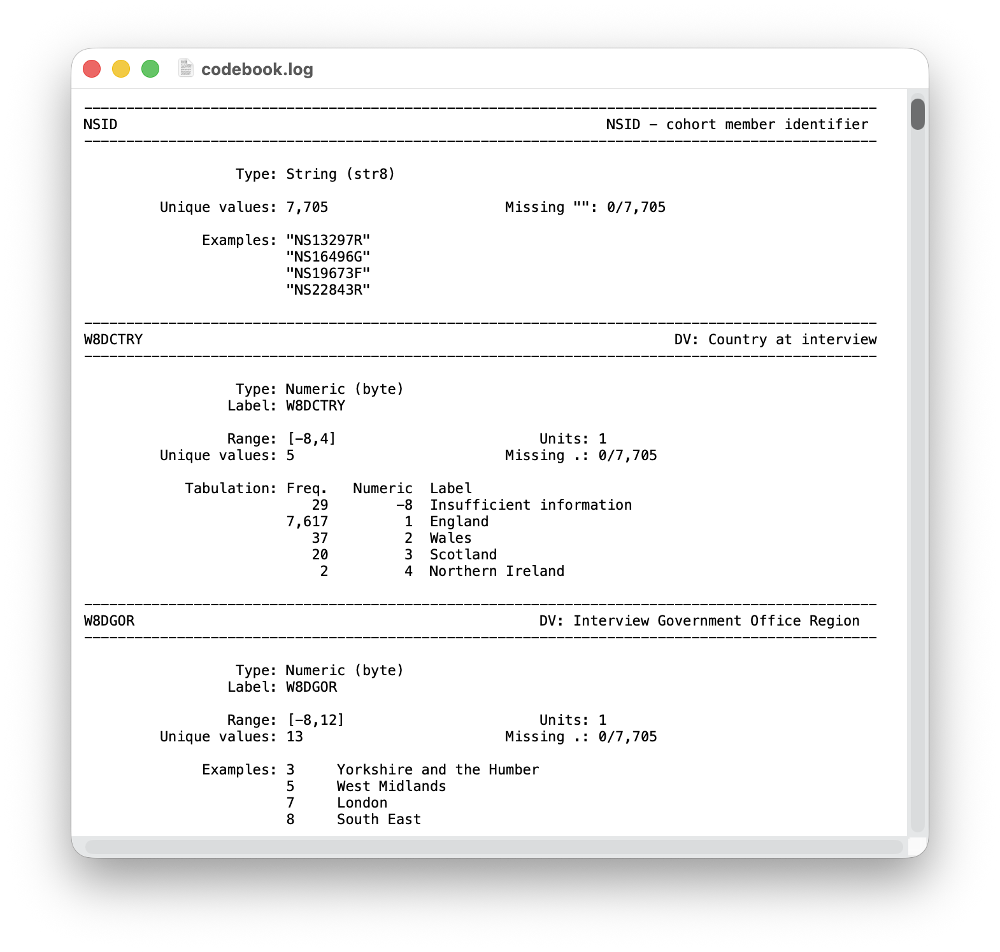

- [Download the Stata script for this
  page](../do_files/next_steps-data_discovery.do)

# Introduction

In this section, we show a few `Stata` commands for exploring Next Steps
data; there’s a lot of data in Next Steps, so finding a specific
variable can be challenging. Variable names do not always follow a
consistent convention across the whole study: Sweeps 1-7 were managed by
the Department for Education and Sweeps 8-9 by CLS, and the same concept
is often named differently in the two eras. (The variable for the cohort
member’s GHQ-12 score is `W2ghq12scr` in Sweep 2 but `W8DGHQSC` in Sweep
8, for example.) In what follows, we will use the `Stata` commands to
find variables for cohort members’ GHQ-12 (12-item General Health
Questionnaire), which has been collected in several of the sweeps.

As a reminder, the Next Steps data files downloaded from the UK Data
Service are stored across three subfolders: `safeguarded_eul`,
`household_grids` and `activity_histories`. The code below assumes that
your working directory is the folder that contains these three
subfolders (see the [*Next Steps* landing
page](https://cls-data.github.io/data-handling-stata/docs/next_steps.html)).

# `lookfor`

The `lookfor` command allows one to search for variables in a dataset by
keyword. It searches variable names as well as variable labels, and the
search is not case sensitive. Below, we read in the Next Steps Sweep 8
(age 25) dataset which contains derived variables
(`safeguarded_eul/ns8_2015_derived.dta`) and use `lookfor` to search for
variables related to the `"GHQ"`.

``` stata
use "safeguarded_eul/ns8_2015_derived.dta", clear
lookfor "ghq"
```

    (:45'G:\DB\dbdeposit\lsype\deposits\Checks\NS8\NS8_2015_Derived.s)

    Variable      Storage   Display    Value
        name         type    format    label      Variable label
    -------------------------------------------------------------------------------
    W8DGHQSC        byte    %8.0g      W8DGHQSC   DV: General Health Questionnaire
                                                    (GHQ12) score (Goldberg &
                                                    Williams,1988)

`lookfor` lists the name, storage type, display format and labels of
each variable it finds. The output shows that GHQ information in the
`safeguarded_eul/ns8_2015_derived.dta` dataset is stored in the variable
`W8DGHQSC`.

# `codebook`

The Next Steps datasets that are downloadable from the UK Data Service
come bundled with data dictionaries within the `mrdoc` subfolder.
However, these are limited in some ways. The `codebook` command enables
the creation of data dictionaries. Below we create a codebook for the
Next Steps Sweep 8 derived variable dataset (the open dataset), saving
it in a log file. The log file, `codebook.log`, is created in the
working directory and can be opened in a text editor.

``` stata
log using codebook.log, replace
    codebook
log close
```



# Create a Lookup Table Across All Datasets

Creating the `lookfor` and `codebook` one dataset at a time does not
allow one to get a quick overview of the variables available in Next
Steps, including the sweeps repeatedly measured characteristics are
available in.

Below we create a dataset that contains information on variables within
all the `.dta` files in the three Next Steps subfolders.

- The code begins by using `filelist` to create a dataset of all of the
  files in the working directory (and its subfolders) whose names end in
  `.dta` (i.e., are Stata datasets). This dataset has one row per file,
  with the folder stored in the variable `dirname` and the name of the
  file in the variable `filename`. `filelist` is a user-written command;
  if you have not used it before, it can be installed by running
  `ssc install filelist` (this line begins with a `*` in the code below,
  which marks it as a comment, so it is not run).
- We then use `keep if` with the `inlist()` function to keep only the
  files that are in the three Next Steps subfolders (`filelist` records
  the name of each folder relative to the working directory, which is
  written as `.`). This drops any other `.dta` files that `filelist` has
  found in the working directory or in other folders within it (for
  instance, the datasets saved by the code on the other pages in this
  section), which would otherwise appear in the lookup table.
- Next, the code loops over each row of the dataset and uses
  `describe *, replace` to create a new dataset containing variable
  names and labels for variables in a given file, with `append` then
  used to stack the datasets generated from `describe` together in long
  format.
  - `tempfile` reserves a name for a temporary file. The file is created
    when data are saved to it, and `Stata` deletes it automatically when
    the code has finished running. The name of the file is stored in a
    `local` macro, with the name specified after `tempfile` (here
    `file_list`). `local` macros can then be referenced (i.e., their
    contents used) by placing the `` `' `` ticks around the macro name.
    In the code below, we also place the macro in double quotes (e.g.,
    `` save "`file_list'" ``) so that the code still works where the
    path to the temporary file contains a space.
  - `_N` is an inbuilt variable equal to the number of rows in the data.
  - `local ...` creates a local macro.
  - `` forvalues i = 1/`n_files' `` loops over the numbers from 1 to
    `n_files`, where `n_files` is the number of files in the list. The
    current value of the loop (1, 2, …, `n_files`) is stored in the
    local macro `i`.
  - `` use "`file_list'" in `i', clear `` reads in the `i`th row of the
    dataset containing the list of files.
  - `local filename = filename[1]` stores the name of the file in the
    local macro `filename`. The `[1]` indicates that we are taking the
    value from the first row of the dataset (there is only one row in
    the dataset at this point, as we are looping over each file one at a
    time).

``` stata
* ssc install filelist
filelist, pattern("*.dta")
keep if inlist(dirname, "./safeguarded_eul", "./household_grids", "./activity_histories") // Keeps files in the three Next Steps subfolders
tempfile file_list
save "`file_list'"

clear
tempfile all_vars
save "`all_vars'", emptyok

use "`file_list'", clear
local n_files = _N
forvalues i = 1/`n_files' {
  use "`file_list'" in `i', clear
  local filename = filename[1]
  local dirname = dirname[1]
  use "`dirname'/`filename'", clear
  describe *, replace
  gen dir = "`dirname'"
  gen file = "`filename'"
  append using "`all_vars'"
  save "`all_vars'", replace
}
```

Unlike the other CLS cohorts, the Next Steps files are not organised
into a separate folder for each sweep. However, as [variable names begin
with a prefix indicating the
sweep](https://cls-data.github.io/data-handling-stata/docs/next_steps-data_structures.html)
(`W1`, `W2`, …, `W9`), we can instead extract the sweep from the
variable name. We do this below with `regexm()`, which tests whether
text matches a regular expression: `"^w([0-9])"` matches a `w` at the
start of the variable name followed by a single digit. Where there is a
match, `regexs(1)` returns the part of the match within the parentheses
(i.e., the digit) and `real()` converts this from text to a number.
Variables that do not have a sweep prefix (for example, `NSID`) are
given a missing value (`.`). Note, we first convert both the variable
names and labels to lower case to make our searches case insensitive.

We can use the resulting dataset to search for variables with `"ghq"` in
their labels.

``` stata
// Not printing output to avoid excessive length.
use "`all_vars'", clear
gen name_low = lower(name)
gen varlab_low = lower(varlab)
gen sweep = real(regexs(1)) if regexm(name_low, "^w([0-9])") // Extracts sweep from the variable name
list dir file sweep name varlab if strmatch(varlab_low, "*ghq*")
```

The sweep prefix also makes it straightforward to see how the name of a
variable changes over time. For instance, below we search for GHQ-12
*scores* (as opposed to the individual GHQ-12 items) by adding a second
condition. The names follow one convention in the Sweep 2 and 4 files
(`W2ghq12scr` and `W4ghq12scr`), and another in the Sweep 8 and 9 files
(`W8DGHQSC` and `W9DGHQSC`).

``` stata
list dir file sweep name varlab if strmatch(varlab_low, "*ghq*") & strmatch(varlab_low, "*score*")
```

Note, local macros and temporary files are deleted once the code that
created them has finished running, so the code in this section needs to
be run in one go (for instance, by running the do-file as a whole)
rather than line-by-line - alternatively, save the datasets to
non-temporary files instead.
